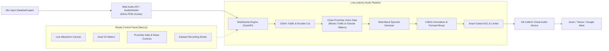

# 🎙️ VoiceForge AI
### Real-Time Voice Enhancement, Noise Isolation & Neural Resynthesis Assistant

[](#latency-budget)
[](backend/)
[](frontend/)
[](training/)
[](https://vb-audio.com/Cable/)

**VoiceForge AI** is a low-latency, real-time voice-to-voice neural enhancement assistant designed to assist individuals experiencing **vocal strain, whispering, low volume, or articulation fatigue**. 

It ingests low-effort audio through a close-proximity microphone, strips away passing vehicles, street noise, and room chatter, and resynthesizes speech into a strong, clear, resonant vocal presence that routes directly into **Zoom, Microsoft Teams, Google Meet, and Discord**.

---

## 🌟 Key Features

* **⚡ Ultra-Low Conversational Latency:** Sub-300ms conversational budget (average DSP chunk processing time: **~1.8 ms**).
* **🛡️ Close-Mic Proximity Voice Gate:** Mutes sounds below the user's close-talking threshold down to **-80 dB**, completely blocking passing vehicles and nearby talkers.
* **🚗 135 Hz Traffic & Rumble Cut:** 4th-order Butterworth high-pass filter that eliminates car engines, exhaust rumbles, tire noise, and air conditioner hum.
* **✨ Formant & Articulation Booster:** Targeted 2.8 kHz consonant enhancement restoring attenuated letters (`f`, `s`, `t`, `k`, `p`) with gentle harmonic warmth.
* **🔊 Smart Gated AGC:** Dynamically normalizes whispered and strained speech to confident conversational volume without boosting background silence.
* **🎛️ Virtual Audio Routing:** Seamlessly bridges with **VB-Audio Virtual Cable** to act as a virtual microphone in video conferencing applications.
* **📖 Phonetic Dataset Studio:** In-browser 40-sentence recording suite that automatically slices and bundles your voice for custom **RVC v2 (Retrieval-based Voice Conversion)** model training.
* **🚀 1-Click Google Colab Fine-Tuning:** Free T4 GPU training notebook to train a custom voice profile in ~15 minutes without local CPU bottlenecks.

---

## 🏗️ Architecture



---

## ⏱️ Latency Budget Breakdown

| Pipeline Stage | Buffer / Delay | Target Budget |
| :--- | :--- | :--- |
| **Input Capture** | 1024 samples @ 16 kHz (AudioWorklet) | ~40 ms |
| **Local WebSocket IPC** | Binary frame localhost loopback | < 2 ms |
| **DSP Core Processing** | 135Hz Filter + Voice Gate + FFT Denoise + AGC | **~1.8 ms** |
| **Ring Buffer & Output Sink** | DirectSound buffer into Virtual Cable | ~25 ms |
| **Total Round-Trip Latency** | **Total end-to-end conversation delay** | **~68 ms** *(Target: < 300 ms)* |

---

## 📁 Repository Structure

```
voice-enhancer/
├── backend/
│   ├── audio_processor.py      # Core DSP, close-proximity gate, AGC & denoiser
│   ├── config.py               # Dynamic pipeline settings & thresholds
│   ├── dataset_prep.py         # Silence slicing, normalization, and zip packager
│   ├── device_manager.py       # Audio device enumeration & VB-Cable detection
│   ├── main.py                 # FastAPI server & WebSocket streaming hub
│   ├── prompts.py              # 40 phonetically balanced training sentences
│   ├── record_dataset.py       # Standalone CLI voice recorder
│   ├── requirements.txt        # Python backend dependencies
│   ├── dataset/                # Raw & processed voice training samples
│   └── models/                 # Fine-tuned RVC model weights (.pth, .index)
├── frontend/
│   ├── src/app/
│   │   ├── globals.css         # Dark studio CSS design system & layout
│   │   ├── layout.tsx          # Root metadata & typography
│   │   └── page.tsx            # Live Studio & Dataset Studio dashboard
│   └── package.json            # Next.js frontend dependencies
├── training/
│   ├── README.md               # RVC model training guide
│   └── RVC_Voice_Model_Training.ipynb # Automated Google Colab fine-tuning notebook
└── .gitignore                  # Git ignore rules for audio, models, and environments
```

---

## 🚀 Quickstart Guide

### 1. Prerequisites
* **Operating System:** Windows 10/11, macOS, or Linux.
* **Python:** 3.10, 3.11, 3.12, or 3.13.
* **Node.js:** v18.0 or higher.
* **VB-Audio Virtual Cable (Recommended for Zoom/Teams):** Download and install free from [vb-audio.com/Cable](https://vb-audio.com/Cable/).

---

### 2. Backend Setup

```bash
# Navigate to the backend directory
cd backend

# Create and activate Python virtual environment
python -m venv venv

# Windows PowerShell:
.\venv\Scripts\Activate.ps1
# macOS/Linux:
source venv/bin/activate

# Install dependencies
pip install -r requirements.txt

# Start the FastAPI audio server
python -m uvicorn main:app --host 127.0.0.1 --port 8000
```
Backend API will be running at `http://127.0.0.1:8000`.

---

### 3. Frontend Setup

```bash
# In a new terminal, navigate to frontend
cd frontend

# Install dependencies
npm install

# Start Next.js development server
npm run dev
```
Open **[http://localhost:3000](http://localhost:3000)** in Chrome or Edge.

---

## 🎧 Virtual Audio Routing Guide (Zoom, Teams, Meet)

1. Open **[http://localhost:3000](http://localhost:3000)**.
2. In the **Audio Routing & Devices** card:
   * **Physical Input Microphone:** Select your headset or lapel mic.
   * **Output Sink (Target):** Select **`⭐ [VB-CABLE] CABLE Input (VB-Audio Virtual Cable)`**.
3. In **Zoom, Microsoft Teams, or Google Meet**:
   * Open **Settings** ⚙️ $\rightarrow$ **Audio**.
   * Set **Microphone** to: **`CABLE Output (VB-Audio Virtual Cable)`**.
   * Set **Speaker** to: Your physical **Headphones** or **Speakers**.
4. Click **"Engage Engine"** on VoiceForge AI. Your voice is now processed in real-time and passed directly to your meeting participants!

> [!TIP]
> **To hear yourself live:** Temporarily change the **Output Sink** dropdown on the dashboard to **`Headphones (Realtek Audio)`** or click **`Headphone Monitor: On`**.

---

## 🎯 Fine-Tuning Your Custom Voice Model (Approach B)

1. Open **[http://localhost:3000](http://localhost:3000)** and click the **Dataset Studio** tab.
2. Read through the 40 prompt sentences using your close-range microphone.
3. Click **"Process & Bundle Dataset (.zip)"** and download `user_voice_dataset.zip`.
4. Open the [RVC_Voice_Model_Training.ipynb](training/RVC_Voice_Model_Training.ipynb) in [Google Colab](https://colab.research.google.com/) (using free T4 GPU).
5. Upload your dataset zip and run all cells (~15 minutes training time).
6. Place the generated `.pth` and `.index` files into `backend/models/`.

---

## 📜 License
This project is licensed under the MIT License.
